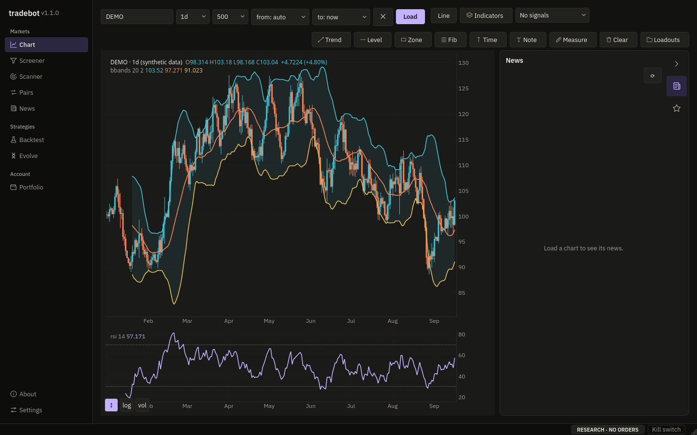
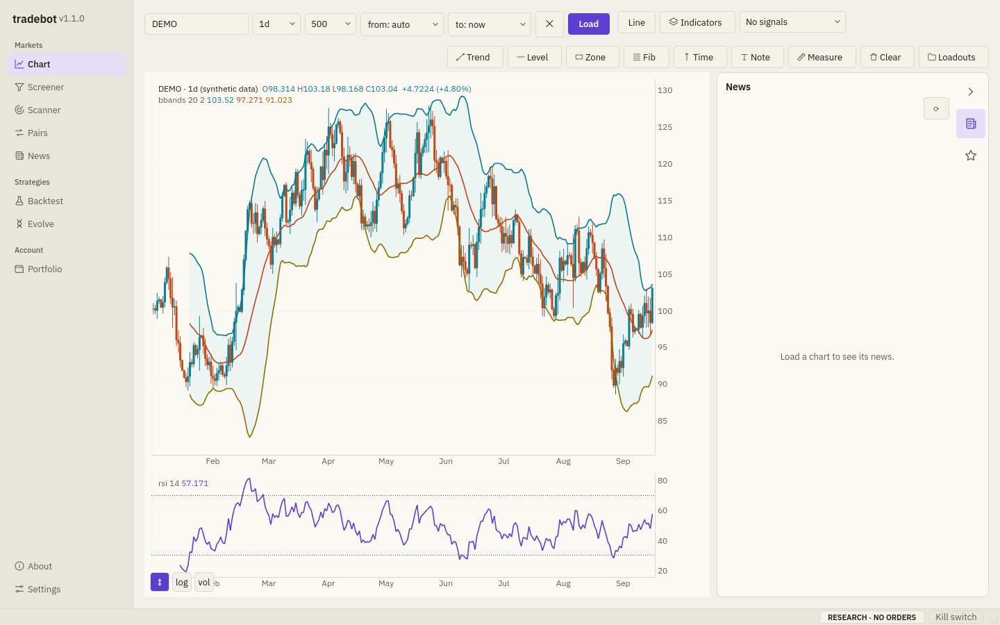

# tradebot

An extensible algorithmic trading platform for crypto and stocks: unified broker adapters, multi-source OHLC data,
pluggable indicators and strategies, a vectorized backtester, a GPU-accelerated genetic optimizer, a strategy evolver, a
PyQt6 desktop app, and a terminal CLI.

Licensed under the **GNU GPL v3.0 or later** (see `LICENSE`).

**Documentation: [docs/index.md](docs/index.md).**

## Disclaimer

**Not affiliated.** tradebot is independent software. It is not affiliated with, endorsed, sponsored or approved by any
broker, exchange or data provider it supports, such as Binance, KuCoin, Pionex, Scalable Capital, Trade Republic or
Yahoo. Their names and trademarks belong to their owners.

**No warranty, no liability.** tradebot is provided "as is", without any warranty (GNU GPL v3, sections 15 and 16). It is
not financial advice, and backtest or optimizer results don't predict future returns. You use it at your own risk; the
author is not liable for any loss, including from bugs, wrong signals, failed or wrongly sized orders, outages, wrong
market data, or misconfiguration. Run a strategy as a dry run, and on a testnet (`--sandbox`), before you use `--live`.

The full text, shown by `tradebot --version` and the app's **About** button, is in
[docs/legal.md](docs/legal.md).

## Install and run

```sh
uv sync --extra gui --extra gpu      # or: pip install -e '.[gui,gpu]'
uv run tradebot --help
uv run tradebot gui
```

Or download a standalone binary for Linux, Windows or macOS (no Python needed, CPU-only, unsigned) from the
[Releases page](https://github.com/daMarxrider/trading_bot_3/releases). Details, the GPU setup, third-party tools and the
first run: [Getting started](docs/getting-started.md).

## A taste

```sh
tradebot chart BTC/USDT --tf 4h --bars 200 -i bbands -i rsi --algo rsi_threshold
tradebot backtest AAPL macd_cross --bars 2000 -p fast=8 -p slow=21
tradebot optimize AAPL macd_cross --walk-forward 5 --holdout 250
tradebot evolve AAPL,MSFT,NVDA --generations 60 --save my_rule
tradebot bot run ETH/USDT sma_cross --tf 1h --stake 50 --paper
```

## Screenshots

The desktop app in its two main themes (synthetic demo candles). Up is blue-teal and down is vermilion, so the
chart reads the same with red-green colour blindness.




## Documentation

* **Getting started**: [install, binary, GPU, first run, cache](docs/getting-started.md)
* **Desktop app**: [Chart](docs/chart.md), [Screener](docs/screener.md), [Scanner](docs/scanner.md),
  [Backtest lab](docs/backtest-lab.md), [Evolve](docs/evolve.md), [Pairs](docs/pairs.md),
  [Basket](docs/portfolio-backtest.md), [Portfolio](docs/portfolio.md), [Journal](docs/journal.md), [News](docs/news.md), [Fundamentals](docs/fundamentals.md), [Settings](docs/settings.md)
* **Command line**: [every command with examples](docs/cli.md), [CLI reference](docs/cli-reference.md), tab completion
* **Extending**: [plugins, indicators, brokers](docs/extending.md),
  [turning an indicator into an algorithm](docs/indicators-as-algorithms.md), `examples/plugins/`
* **Concepts**: [strategies](docs/strategies.md) (incl. Elliott waves and the halving cycle), [metrics](docs/metrics.md),
  [the optimizers](docs/optimizers.md), [data and the cache](docs/data.md),
  [brokers, bots, paper trading and risk guards](docs/live-trading.md), [pairs trading](docs/pairs-trading.md), [regimes and position sizing](docs/regimes-and-sizing.md), [pattern detection](docs/patterns.md),
  [multi-timeframe indicators](docs/multi-timeframe.md) (e.g. `close > sma(200, tf=1d)` on hourly candles),
  [shorts, leverage and liquidation](docs/shorts-and-leverage.md), [alerts](docs/alerts.md)
* **Reference**: [config keys, settings.json, environment variables, file locations](docs/reference.md)
* **Development**: [tests, CI, branches, releases](docs/development.md); [disclaimer and licence](docs/legal.md)

## Architecture in brief

**One execution model.** An algorithm returns a target position per candle (1 long, 0 flat, -1 short when allowed). The
position decided at candle *t*'s close earns candle *t+1*'s return, and fees (plus optional slippage) are charged on every
position change. The backtester, the optimizer and the live bot all use this model, so there is no look-ahead and live
behaviour matches backtests.

**Data fallback.** Providers are tried in order (Binance, KuCoin, Kraken, Yahoo, then keyed APIs); only the missing head or
tail of a range is requested from the next one, so history from different venues is stitched together.

**Brokers.** Every broker has the same `get_ticker`, `get_klines`, `place_order`, `cancel_order` and `get_balance`
methods: `live` (ccxt venues), `semi_auto` (no trading API: Scalable Capital, Trade Republic) and `read_only`.

The source layout is in [Development](docs/development.md#layout).

## Development

```sh
uv run pytest
uv run pytest --slow                 # also the minutes-long tests
python scripts/check_docs.py         # the docs check CI runs
```

See [Development](docs/development.md) for CI, branches and the release labels.
